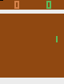
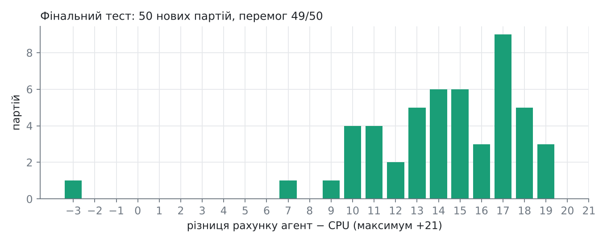
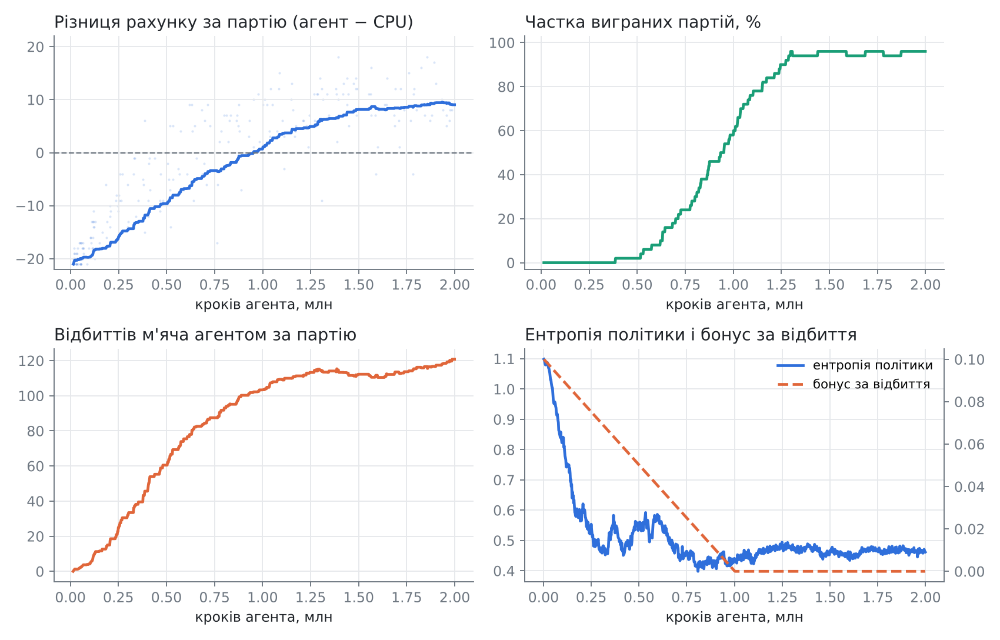

<p align="center">
  
  
  
  
</p>

# PongAI: нейронна мережа грає в Atari Pong

Нейронна мережа Actor-Critic вчиться з нуля, методом PPO, грати в **Pong (Atari 2600)** проти вбудованого комп'ютерного суперника. Середовище: `ALE/Pong-v5` (Gymnasium + Arcade Learning Environment) зі стандартними «липкими діями» (sticky actions, 25%), тобто ALE з імовірністю 25% повторює попередню дію замість щойно вибраної. Через це гра стає менш передбачуваною й складнішою.

Навчання почалося з випадкових ваг і тривало **2 млн кроків агента** (≈8 млн кадрів гри, ~12 хв на звичайному CPU). На **50 нових тестових партіях** фінальна модель виграла **49 (98%)**. Середній рахунок **20,3 : 6,1**.

<p align="center"></p>

Проєкт написано на основі ідей [SnakeAI v9](https://github.com/YuriiDehtiar/TrainAI_Snake): PPO, окремі мережі Actor і Critic, відтворювані налаштування в JSON, окреме оцінювання на фіксованих seed.

## Швидкий запуск

```bash
python -m venv .venv
source .venv/bin/activate          # Windows: .\.venv\Scripts\Activate.ps1
pip install -e ".[play]"

pong-play                          # показ гри навченої моделі у вікні
pong-evaluate --episodes 50 --seed 900000 --out results/my_eval.json
pong-train --config configs/training.json --run-name my_run   # нове навчання з нуля
pong-record --seed 900045 --out docs/assets/pong_agent.gif     # запис GIF
```

ROM Pong входить до пакета `ale-py` (≥ 0.9), окремо завантажувати нічого не потрібно. Навчання й гра працюють на CPU, GPU не потрібен.

## Результати

### Фінальний тест: 50 нових партій (seed 900000–900049)

Ваги не змінювалися, мережа завжди обирала найімовірнішу дію, sticky actions = 0,25.

| Показник | Значення |
|---|---:|
| Перемоги | **49 / 50 (98%)** |
| Середній рахунок (агент : CPU) | **20,3 : 6,1** |
| Середня різниця рахунку | **+14,2 ± 3,8** |
| Партій дограно до 21 очка | 36, усі виграні (CPU набирав від 2 до 11 очок) |
| Середня кількість відбиттів м'яча за партію | 160 |



**Збій ALE при дуже довгих партіях.** Агент багато розігрує, тож його партії довгі: 9–16 тис. кроків. Приблизно після 15,5–16,3 тис. кроків (≈62–65 тис. кадрів) гра може дати збій. Винагорода раптом стає +6, рахунок CPU на табло скидається, і далі гра більше не зараховує очок, аж до ліміту `Pong-v5` (27 000 кроків). Так сталося в 14 партіях із 50. Очки в оцінюванні рахуються за приростом табло, тому збій не завищує результат. Агент вів у рахунку в 13 із цих 14 партій. Єдина поразка (13:16) якраз така «заморожена» партія.

### Прогрес навчання (по 10 партій, seed 800000–800009)

| Модель | Кроків | Перемоги | Рахунок агент : CPU |
|---|---:|---:|---:|
| Випадкові дії | 0 | 0 / 10 | 0,7 : 21,0 |
| Ітерація 100 | 0,2 млн | 0 / 10 | 10,3 : 21,0 |
| Ітерація 250 | 0,5 млн | 7 / 10 | 20,4 : 15,2 |
| Ітерація 500 | 1,0 млн | 10 / 10 | 21,0 : 6,9 |
| Ітерація 750 | 1,5 млн | 10 / 10 | 19,9 : 7,8 |
| Фінальна (976) | 2,0 млн | 10 / 10 | 20,5 : 6,2 |



Графіки навчання будуються за останніми 50 завершеними навчальними партіями. Під час навчання дії вибираються випадково з імовірностей мережі, тому ці цифри нижчі, ніж у тесті з найімовірнішою дією.

## Як це працює

### Спостереження (12 ознак)

Мережа не бачить пікселів. Обгортка `PongFeatures` читає з RAM приставки координати м'яча та обох ракеток (адреси за AtariARI) і будує вектор із 12 чисел, нормованих приблизно до [−1, 1]:

| № | Ознака |
|---|---|
| 0 | м'яч на полі (0/1) |
| 1–2 | координати x, y м'яча |
| 3–4 | швидкість м'яча dx, dy (різниця між кроками) |
| 5–6 | положення та швидкість нашої ракетки |
| 7–8 | положення та швидкість ракетки суперника |
| 9–10 | висота м'яча відносно нашої ракетки та ракетки суперника |
| 11 | прогноз, на якій висоті м'яч долетить до нашої ракетки (з відбиттями від стін), відносно ракетки |

Дії: **3** (на місці / вгору / вниз). `FIRE` не потрібен, бо подача в Pong автоматична. Рішення завжди приймає мережа, жодних підказок чи замін дій немає.

### Мережа

Actor і Critic мають окремі ваги й однакову будову (ініціалізація orthogonal):

| Частина | Розмір | Активація |
|---|---|---|
| Вхід | 12 | — |
| Прихований шар 1 | 128 | Tanh |
| Прихований шар 2 | 128 | Tanh |
| Вихід Actor | 3 логіти дій | Softmax у розподілі дій |
| Вихід Critic | 1 оцінка майбутньої винагороди | лінійний |

Усього ≈37 тис. параметрів.

### Система винагород

| Подія | Винагорода |
|---|---:|
| Агент виграв очко | +1 |
| CPU виграв очко | −1 |
| Агент відбив м'яч | +0,1 → 0 (лінійно зменшується до нуля за першу половину навчання) |

Бонус за відбиття допомагає на старті: випадковий агент майже ніколи не забиває, і без бонусу сигнал був би дуже рідкісним. Другу половину навчання бонус дорівнює нулю, тож мережа оптимізує тільки рахунок гри і не «фармить» відбиття.

### Налаштування PPO (`configs/training.json`)

| Параметр | Значення |
|---|---:|
| Паралельних ігор | 16 (2 процеси) |
| Кроків на гру за ітерацію | 128 (батч 2048) |
| Епох на ітерацію / мінібатч | 4 / 512 |
| Learning rate | 2,5·10⁻⁴, лінійно до 0 |
| γ / λ (GAE) | 0,99 / 0,95 |
| Clip PPO / clip градієнта | 0,2 / 0,5 |
| Коефіцієнти ентропії / цінності | 0,01 / 0,5 |
| Всього кроків | 2 000 000 (976 ітерацій) |

## Організація репозиторію

```text
src/pong_ai/env.py        обгортка Pong: ознаки з RAM, бонус за відбиття, рахунок табло
src/pong_ai/model.py      мережа Actor-Critic, збереження/завантаження
src/pong_ai/vec_env.py    паралельний запуск ігор у кількох процесах
src/pong_ai/cli/          команди: train, evaluate, play, record
configs/training.json     відтворювані налаштування навчання
models/                   фінальна модель і проміжна (ітерація 250)
results/                  історія навчання, партії, результати оцінювання
docs/assets/              графіки, GIF, кадр гри
tools/plot_results.py     побудова графіків
tests/                    перевірки середовища та моделі (pytest)
```
